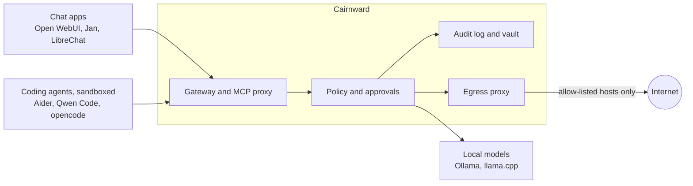

# Cairnward

**A local privacy gateway for AI clients and agents, for one person on one machine.**

Local AI tools run on your computer, but they rarely show what they did or enforce what can
leave it. Cairnward sits between your chat apps, coding agents and models. It checks every
model call, tool call and outbound connection against a policy you control, records them in a
tamper-evident log, and runs tools in a sandbox whose only network route goes through Cairnward.

> **Status: early (v0.0.1), not ready to rely on.** It has been tested on one Linux machine,
> hasn't had an independent security audit, and has no releases yet. See [Status](#status).

## What it does

- **One local endpoint.** An OpenAI-compatible gateway for models and an MCP proxy for tools,
  with a separate API key per client.
- **Isolation enforced by the OS.** Agents, MCP servers and Cairnward's own core run in a
  sandbox with no network of their own. Their only way out is the egress proxy, which applies
  your allow-list.
- **Tamper-evident audit log.** A hash-chained record of every effect, written before it
  happens. It stores digests of prompts, not the text. `cairnward audit verify` checks the chain.
- **Your own copy of conversations.** A searchable vault, whichever client you used, encrypted
  per conversation. Lock with a passphrase, or purge by destroying the key.
- **Approvals outside the model.** Risky actions wait for your answer, and a model can't approve
  its own. Changed MCP tools are detected and disabled.
- **Reviewable agent runs.** `cairnward run` snapshots the project before and after, so you can
  diff or undo what an agent did, and set limits on requests, tokens and time.
- **Literature research.** Ask questions of a folder of PDFs and get answers cited to the page,
  or run a review as an overnight batch job, with APA or IEEE references and checked quotations.
- **Built for CPU-only machines.** Scheduling, context limits and waiting-time estimates come
  from benchmarks on a desktop with no GPU.

Every protection can be switched off, and weakening one is visible and audited.

## How it fits together



## Privacy presets

`cairnward setup` asks you to choose one. Any setting can be overridden globally or per
environment.

| Setting | Open | Balanced | Strict |
|---|---|---|---|
| OS isolation | off | on | on |
| Network access | open | ask | allow-list |
| Hosted model backends | allow | ask | deny |
| Approvals | off | high risk only | by risk tier |
| Redaction of outbound text | off | warn | enforce |
| Conversation vault | off | full | full |
| Audit log | on | on | on |
| External audit checkpoints | off | off | git |
| Per-conversation keys (crypto-shredding) | off | on | on |
| MCP tool pinning | off | on | on |

## Quick start

You need Linux (developed on Debian and Ubuntu), Python 3.12+, [uv](https://docs.astral.sh/uv/)
and [Ollama](https://ollama.com/). The sandbox also needs Node.js 22.12+, bubblewrap, socat and
ripgrep:

```bash
sudo apt install git bubblewrap socat ripgrep
```

Install Cairnward from the repository:

```bash
git clone https://github.com/c23075/possessed-incantation.git ~/cairnward
```

```bash
cd ~/cairnward && uv sync
```

Pull the default models. The main model needs about 18 GB of memory at the default context, and
the [full setup guide](docs/getting-started.md) explains how to choose others.

```bash
ollama pull qwen3:30b && ollama pull qwen3:1.7b && ollama pull qwen3-embedding:0.6b
```

Choose a preset, install the sandbox and check that the protections work:

```bash
uv run cairnward setup --install-sandbox
```

Start it and leave it running. The gateway is at `http://127.0.0.1:8484/v1`:

```bash
uv run cairnward serve
```

Then, in another terminal, create an API key for a client and open the dashboard:

```bash
uv run cairnward client add my-chat-app
```

```bash
uv run cairnward dashboard
```

## Using it

Run a coding agent in the sandbox from your project folder, then review what it changed:

```bash
uv run --project ~/cairnward cairnward run --profile aider --env coding -- aider
```

```bash
uv run cairnward runs diff <run-id>
```

Ask questions of a folder of PDFs:

```bash
uv run cairnward library create thesis ~/papers --env litreview-offline
```

```bash
uv run cairnward library index thesis
```

```bash
uv run cairnward library ask thesis "How far did the glacier retreat?"
```

See what happened, and check that the log is intact:

```bash
uv run cairnward audit log --last 30
```

```bash
uv run cairnward audit verify
```

Client setup guides: [Open WebUI](docs/clients/open-webui.md), [Jan](docs/clients/jan.md),
[LibreChat](docs/clients/librechat.md), [Aider](docs/clients/aider.md),
[Qwen Code](docs/clients/qwen-code.md), [opencode](docs/clients/opencode.md),
[Goose](docs/clients/goose.md), [MCP](docs/clients/mcp.md).

## Status

Measured for real on the reference machine (AMD Ryzen 3 3200G, 29 GB RAM, no GPU), through the
isolated server, on [synthetic test papers](docs/bench/):

| Check | Result |
|---|---|
| Page-cited answers (`lit.ask`) | 8/8, nothing invented, on both engines, about 4 to 6 minutes per question |
| Fixing a failing test with Aider | Passed 3 of 3, in about 3 to 7 minutes |
| Literature review pipeline | 12/12 through the isolated server, about 23 minutes for 4 papers. An earlier isolated run scored 9/12 when screening excluded a borderline paper; excluding now takes two tries that agree, which lowers that risk without removing it |
| Gateway overhead | 7 ms with protections off (meets target); 105 ms under Strict with isolation (misses the 50 ms target) |
| Core memory and start | 122 MB (meets target); starts in about 2.8 s with isolation on empty data (target 3 s) |
| First token, model loaded | 11 to 14 s fast model, 22 s main model (meets targets) |

**Not yet tried against the real thing,** only against stand-ins: academic APIs, Zotero, Drive
mirror, remote backups, hosted providers, a real remote MCP server or OAuth provider, and the
chat apps' manual checklist. Everything above used short synthetic papers, not real ones.

**Known gaps:** locking a research library doesn't cover its source PDFs, the release workflow has never run, and no
one but the assistant that wrote the code has reviewed its security. It's meant for Linux; CI
also runs the unit tests on Windows.

The current state and next steps are in the newest [handoff](docs/plan/), and each requirement's
status in [requirements-status.md](docs/plan/requirements-status.md).

**What this doesn't protect against:** it controls traffic and tools that pass through it. It
can't see what a chat app does outside its own sandbox if you run the app unconfined, and
locking doesn't erase earlier plaintext from disks or old backups. Read the
[threat model](docs/threat-model.md) before relying on it.

## Documentation

- [Getting started](docs/getting-started.md): the full setup guide
- [Specification](docs/spec.md): the design and its decisions
- [Requirements](docs/requirements.md) and [architecture decisions](docs/adr/)
- [Threat model](docs/threat-model.md)
- [Benchmarks and results](docs/bench/)

## Development

```bash
uv sync
```

```bash
uv run ruff check . && uv run ruff format --check . && uv run mypy
```

```bash
uv run pytest -q
```

The sandbox and browser tests skip when their prerequisites are missing, so a passing run
doesn't always mean they ran. See [CLAUDE.md](CLAUDE.md) for how to enable them, and
`uv run cairnward check` for the full real-model check on your machine.

## License

[Apache-2.0](LICENSE)
