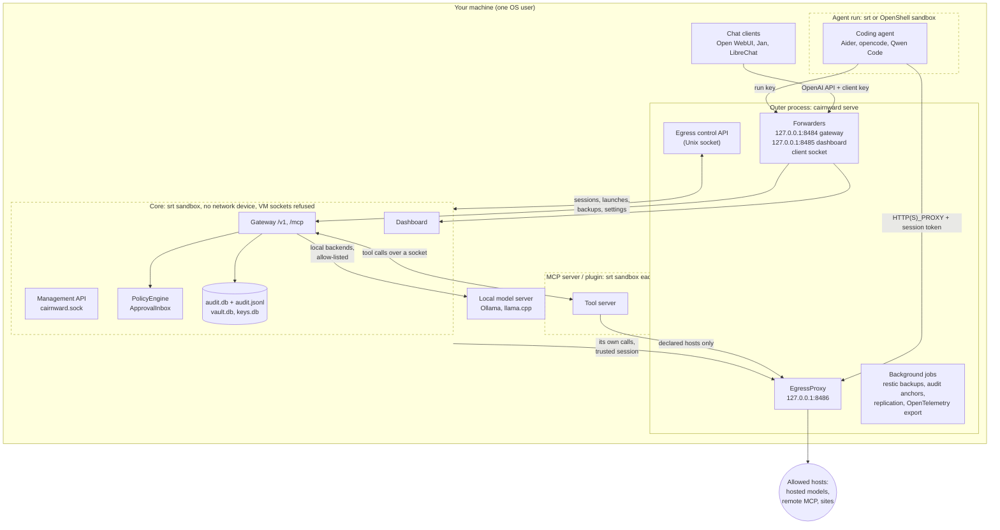
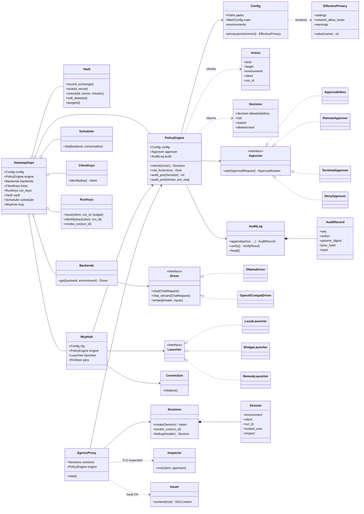
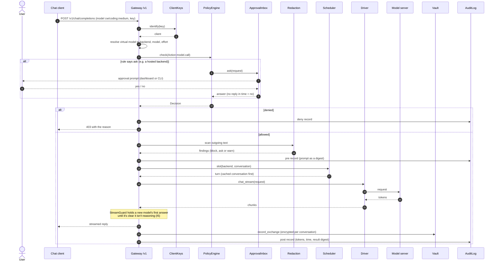
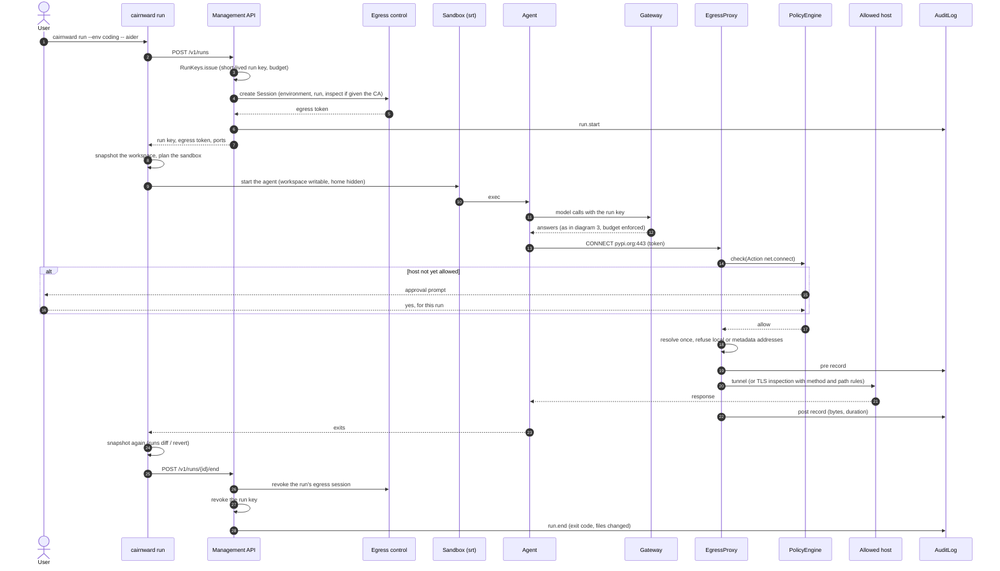
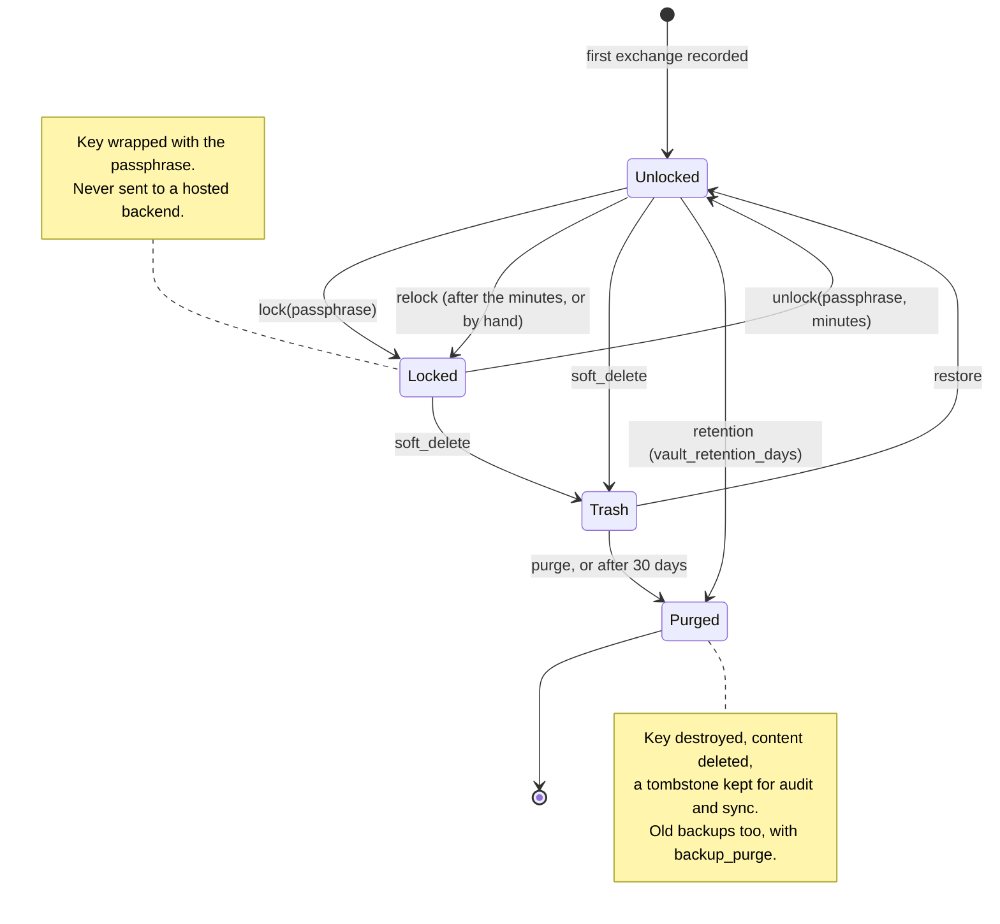

# Cairnward in UML

Written 2026-11-09 from the code on `main`. Class and method names are the real ones. The
diagrams are Mermaid, which GitHub renders, so they can be edited like the rest of the docs. The
prose description of the architecture is in [spec.md §3](spec.md#3-architecture); what the
protections don't do is in [limitations.md](limitations.md).

## 1. Deployment: processes and sandboxes (isolated mode)

Each box with a dashed border is an OS sandbox (srt: bubblewrap and seccomp). Only the outer
process has network access.

With isolation off, the outer process and the core are one process. Agents and MCP servers in
an environment with isolation on are still sandboxed.

## 2. Classes: the core and its decisions

Main classes and how they hold each other. Fields and methods are a selection, not the full
interfaces.

## 3. Sequence: a chat request through the gateway

A request from a chat client, with the protections on (Balanced or Strict).

## 4. Sequence: a sandboxed agent run going out to the network

`cairnward run -- aider` in an environment with `network = "ask"`.

## 5. State: a conversation in the vault

With `crypto_shred = "on"`: each conversation has its own key, and purging destroys it.

