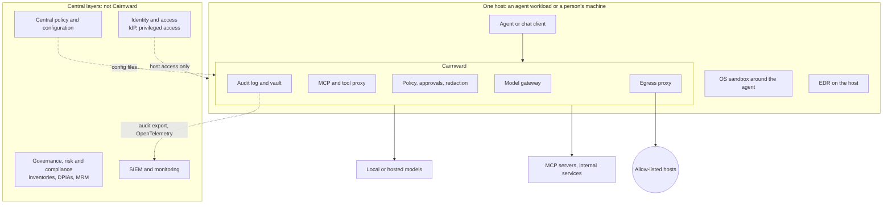

# Using Cairnward in a privacy-regulated company's agent governance

Written 2026-11-06 for security, privacy and compliance teams, and for the engineers who build
in-house agents. It describes how Cairnward could serve as one layer of governance for agentic
systems, what it would contribute, and what the company would still need to supply. The last
section is a plan (added 2026-11-09): an enterprise proof of concept, LLMOps and model risk
management.

This isn't legal advice, and Cairnward isn't certified against any standard. Where this page
names a regulation or standard, it's to show which kind of requirement a feature can help
evidence, not to say that using Cairnward meets it. Your privacy counsel or data protection
officer decides that.

## The short answer

Cairnward can be a **per-host enforcement and evidence layer** for agents: one instance next to
each agent workload or on each person's machine. It **can't be your whole governance layer.**
- **Designed for one user:** it has no users, roles, central policy or central log store.
- **Not production ready:** it hasn't had an independent review, and several features have only
  been tested against stand-ins.

Read [limitations.md](limitations.md) before deciding. A regulated company should adopt it only
with:
1. an engineering team that owns it, as a fork or an internal product;
2. an independent security review and penetration test;
3. a data protection impact assessment for each agent system it fronts;
4. the central pieces this page lists under "What the company must add".

## Where it sits in an agentic system stack

An enterprise stack for agentic systems has several layers, usually supplied by different
products. Cairnward covers the **runtime** layers on one host, between the agent and everything
it reaches (models, tools, the network, the file system), and produces evidence for the layers
above. It has none of the central layers.

| Layer | Usually supplied by | Cairnward's role |
|---|---|---|
| **Governance, risk and compliance** (AI inventories, DPIAs, model risk management, mapping to the AI Act or ISO/IEC 42001) | GRC platforms, the DPO's and MRM teams' processes | **None.** It produces evidence these processes can use ("What Cairnward contributes" below) |
| **Identity and access** (agents as accounts, roles, privileged access) | Identity provider, privileged-access tooling, workload identity | **Weak.** API keys per client and short-lived keys per run; no users or roles. Approvals come from whoever owns the host |
| **Central policy and configuration** | Policy engines, configuration management | **Local only.** TOML files on the host; deliver them with configuration management and alert on drift |
| **Model gateway** (routing, provider control, budgets) | Commercial AI gateways, LLM proxies | **Yes, on the host.** OpenAI-compatible endpoint; hosted providers allowed, asked about or denied per environment; providers that may train on prompts confined to scratch environments; budgets |
| **Data loss prevention and redaction** | Enterprise DLP, CASB | **Partial.** Text redaction in model, MCP and plugin traffic (its own patterns, optionally Presidio). Attachments and images aren't scanned |
| **Tool and MCP governance** | MCP gateways, agent platforms | **Yes.** Tool definitions pinned by hash, allow / ask / deny per tool, changed tools held for review, untrusted content tracked before user-only actions |
| **Containing the agent on the host** | Containers and VMs, EDR | **Yes.** Agents run in an OS sandbox (srt or OpenShell): writes only to the workspace, the home folder hidden, network only through egress. EDR still watches the whole host |
| **Network egress control** | Secure web gateway, firewall, TLS-inspecting proxy | **Yes, per agent.** Network off by default, host allow-lists or a prompt per host, DNS checks against reaching this machine, optional TLS inspection with method and path rules |
| **Human oversight** | Workflow and approval tools | **Yes, on the host.** Approvals in Cairnward's own interface, never answered by the model |
| **Logging and monitoring** | SIEM, OpenTelemetry pipelines | **Produces the records, doesn't store them centrally.** Hash-chained, content-free audit log with anchors, JSON-lines export and OpenTelemetry spans |
| **Data lifecycle** (retention, erasure, encryption) | Records management, key management | **Yes, for its own data.** Conversations encrypted one by one, crypto-shredding on purge, retention per environment, encrypted backups |

**How to read it:** Cairnward is an enforcement point, not where policy is decided. It keeps
control outside the model, which is treated as untrusted. It fits best where central products are
weak: local or self-hosted models with regulated data, separating data classes or matters, and
agents on people's own machines. The central layers are what "What the company must add" lists,
and the planned control plane at the end of this page would supply some of them.

## What Cairnward contributes

Each control below runs on the machine where Cairnward runs, and is switchable per environment.

| Governance need | What Cairnward does | Evidence it produces |
|---|---|---|
| **Data minimisation, and preventing disclosure** | Network off by default. Each environment has an allow-list of hosts or asks per host. Redaction of secrets and personal data in model, MCP and plugin traffic: block, ask or warn | Every connection and refusal in the audit log. Egress report per conversation (hosts, bytes) |
| **Control over third-party AI processors** | Hosted models denied, asked about or allowed per environment. Providers that may train on prompts confined to scratch environments. Locked conversations never sent out. HTTPS required | `model.call` records naming backend, environment and client. Settings snapshots show which providers were allowed when |
| **Least privilege for agents** | Agents in an OS sandbox: writes only to the workspace, the home folder hidden, network only through Cairnward. Each MCP server with a declared manifest. Tools pinned and approved per definition. Per-tool allow / ask / deny | `tool.call`, `mcp.approve`, `mcp.tool_changed`, `run.start` and `run.end` records |
| **Human oversight** | Approvals for risky actions, answered in Cairnward's own interface, never by the model. User-only actions such as encrypting or enabling hosted backends | Each question and answer, with who answered, the scope, and untrusted content that preceded it |
| **Segregation of data** | Environments per data class, client or matter, each with its own models, tools, network rules, vault retention and audit setting. The gateway refuses a run's calls outside its environment | Environment on every record |
| **Record of activity** | Hash-chained, content-free audit log of model calls, tool calls, connections, approvals, runs, settings changes, vault actions and backups. Optional signed anchors to a repository you own, and RFC 3161 timestamps | `audit verify`, `audit verify --anchors`, JSON-lines export, OpenTelemetry spans for model and tool calls |
| **Retention and erasure** | Vault retention per environment. Purging destroys the conversation's key (crypto-shredding) and can rewrite backups (`backup_purge`) | `vault.purge`, `vault.retention` and `backup.purge` records, with tombstones |
| **Access and portability** | Vault export of a conversation as text | `vault.export` records |
| **Confidentiality at rest** | Conversations encrypted per conversation. Optional passphrase locking, an optional recovery key, and encrypted backups | Lock and unlock records |
| **Change control on policy** | Every settings change is recorded with its difference, and weakening is flagged. Plugins and MCP servers pinned by hash | `settings.snapshot`, `settings.changed` |
| **Spend and runaway limits** | Budgets per run, environment and client | `429 budget_exceeded`, audited |

Examples of where these help, depending on your obligations:
- **GDPR:** data minimisation and security of processing (Art. 5(1)(c), Art. 32), records
  supporting accountability (Art. 5(2)), erasure and access requests (Art. 17, Art. 15).
- **ISO/IEC 27001 controls:** logging, access restriction and supplier relationships.
- **ISO/IEC 42001 and the EU AI Act:** human oversight and record-keeping for AI systems.

Check each against your own requirements; none is met by Cairnward alone.

## How to deploy it

Cairnward listens only on the machine it runs on, and assumes one owner. That leaves two
patterns that fit, and one that doesn't.

**Pattern A: a sidecar per agent workload.** This is the recommended one for in-house agentic
systems.
- **The host:** each agent system runs on its own host or VM, under a dedicated service account,
  with its own Cairnward instance.
- **Models:** the agent uses Cairnward's OpenAI-compatible endpoint (`/v1`) with its own client
  key, or runs under `cairnward run` to be sandboxed.
- **Tools:** come only through Cairnward's MCP endpoint, as servers declared in `mcp.toml`.
- **Internal services** the agent needs, such as a document store or a CRM, are either MCP
  servers with a permission manifest, or hosts on the environment's allow-list.
- **Larger components** can be built as a plugin under the plugin contract
  ([plugins.md](plugins.md)), running in a sandbox with no network of its own and using
  Cairnward's services.
- **Why it fits:** one instance per workload keeps "one owner" true. The audit log and vault
  belong to that workload, and the host's administrators are the owner.

**Pattern B: on each employee's workstation,** for people who run coding or research agents
themselves.
- Ship a locked baseline configuration with your device management (see below).
- Collect each machine's audit log and anchors centrally.
- The employee can still loosen settings. That's recorded, not prevented, so this pattern works
  only with monitoring of `settings.changed` and periodic checks.

**Not supported: one shared gateway for many users.** Running one instance for a team means
exposing it beyond the machine, and mixing users' data in one vault and audit log. It has no
authentication, roles or separation for that. Building it would be a new design, with its own
threat model.

## Recommended configuration for heavy compliance

Start from the Strict preset everywhere, then decide each line deliberately. Any value weaker
than Strict shows as such and is audited.

| Setting | Value | Why |
|---|---|---|
| `preset` | `strict` | All protections on |
| `isolation` | `on` | Without it, network and file rules are advisory |
| `network` | `allowlist`, with exact hosts | No asking at run time; unattended agents need a fixed list |
| `hosted_backends` | `deny`, or `ask` for an environment cleared by your vendor review | Hosted providers see prompts in plain text |
| `training_backends` | `scratch_only` | Providers that may train on prompts never see regulated data |
| `redaction` | `enforce` | Secrets blocked, personal data needs approval. Install Presidio and set `[redaction] presidio = true` |
| `[redaction] custom` | Patterns for your own identifiers: client codes, matter numbers, internal IDs | Built-in patterns don't know them |
| `vault` | `full`, or `digests` where you mustn't keep content | `digests` keeps only the audit trail |
| `crypto_shred` | `on` | Makes erasure reliable. With `off`, content is stored as plain text |
| `vault_retention_days` | Your retention schedule, per environment | Purges automatically, and records it |
| `backup_purge` | `on` | Purges also reach backups |
| `audit` | `on` | |
| `audit_anchor` | `git`, with `[anchor] repo`, and `tsa_url` | Proof that holds even if the host is compromised, and trusted timestamps |
| `mcp_pinning` | `on` | Changed tool definitions are disabled until reviewed |
| `home_access` | `hidden` | |
| `egress_report` | `on` | |
| `tls_inspection` | Only where method and path rules are needed, and with the CA key managed as a secret | Adds visibility, but also risk (T-33) |
| `[run_budget]`, client budgets | Set | Stops runaway agents |

Also:
- **Use one environment per data classification,** or per client or matter. Give each its own
  allow-list, MCP servers, retention and backends. Don't share an environment across matters
  that need an ethical wall.
- **Turn on full-disk encryption on every host.** Unlocked conversations' keys are on the same
  disk as the vault. Lock conversations that hold special-category data.
- **Keep the backup password, the anchor signing key and any recovery key** in your secrets
  manager, not on the host.
- **Point agents at local models** for anything regulated. A hosted model is a processor
  relationship that needs its own contract and assessment.

## What the company must add

| Gap | Compensating control |
|---|---|
| **No identity or roles.** Approvals and settings belong to the host's owner | Pattern A: restrict host access to named administrators with your identity provider and privileged-access tooling. Approvals are then made by those administrators, with the OS account as the identity |
| **No central policy.** Configuration is local files the owner can change | Deliver the config folder with configuration management, compare it with a signed baseline, and alert on drift. Alert on every `settings.changed` and `audit.disabled` record |
| **No central audit store** | Ship `audit.jsonl` to your SIEM with a log agent. Keep each host's anchors repository centrally and run `audit verify --anchors` on a schedule. The OpenTelemetry export can feed a collector on the same host that forwards elsewhere; it covers model and tool calls only |
| **No audit retention or legal hold** | Retain and expire records in your SIEM under your schedule. Vault retention purges conversations, so suspend `vault_retention_days` for environments under legal hold |
| **Redaction is incomplete,** text only, and recognises little that's specific to you | Custom patterns, Presidio, `enforce` mode, local models for regulated data, and your own DLP on the hosts |
| **Attachments aren't scanned** | Don't pass images or files to hosted models from regulated environments |
| **Allowed hosts can receive anything** | Keep allow-lists to the hosts a workload truly needs. Use TLS inspection with method and path rules where an allowed host offers dangerous actions. Watch egress volumes |
| **Unproven platforms and features** | Run only on Linux hosts. Treat stand-in-tested features (hosted providers, remote MCP, OpenShell, TLS inspection) as pilots until tested in your environment |
| **No independent review** | Commission a security review and penetration test of your build. Repeat the threat model ([threat-model.md](threat-model.md)) for your deployment |
| **Maintenance** | Pin a reviewed version. Track dependencies (they're hash-locked). Own security fixes, because this is a one-person project |

## Data flows for an impact assessment

These are the flows a data protection impact assessment would need to describe for each agent
system behind Cairnward. The step numbers in the table match the list below.

1. User or system input reaches the agent.
2. The agent calls the model through Cairnward's gateway. Redaction applies; the model may be
   local or hosted.
3. The exchange is stored in the vault, encrypted, unless `vault` is `digests` or `off`.
4. The agent calls tools through Cairnward's MCP endpoint. Tool servers may reach their declared
   hosts through egress.
5. The agent's other network traffic goes through egress, to allowed hosts only.
6. Audit records of every step stay on the host, and are shipped to your SIEM.
7. Backups are encrypted with restic and stored in your repository. If set, replication goes
   through an encrypted shared folder.

| Step | Where the data is | In plain text to |
|---|---|---|
| 2, local model | The host | The model server on the host |
| 2, hosted model | The provider | The provider, under its terms |
| 3 | `vault.db` | Anyone with the disk, for unlocked conversations, unless the disk is encrypted |
| 4 | Tool servers | The tool server, and the hosts it reaches |
| 5 | Allowed hosts | Those hosts |
| 6 | Audit log, SIEM | No content: metadata and digests |
| 7 | Backup repository | Nobody without the backup password |

## Adopting it in stages
1. **Evaluate.** Read [limitations.md](limitations.md), [threat-model.md](threat-model.md) and
   [status.md](status.md). Decide whether to own a fork.
2. **Pilot one workload** with Pattern A, on non-regulated data:
   - set up the configuration above, anchoring and SIEM shipping;
   - run the agent's real tasks, and tune allow-lists and tool approvals;
   - measure how often approvals and redaction interrupt it.
3. **Harden:**
   - an independent review and penetration test;
   - a restore test of the backups;
   - an incident-response runbook that uses the audit log and anchors;
   - a data protection impact assessment.
4. **Limited production** on regulated data, with drift monitoring and scheduled
   `audit verify --anchors`.
5. **Scale** workload by workload. Revisit whether the gaps above justify building central policy
   and audit services around Cairnward, or adopting a commercial gateway that has them
   ([landscape.md](landscape.md)).

## Planned: an enterprise proof of concept, LLMOps and model risk management

Added 2026-11-09. This section is a plan: **nothing new in it is built yet.** The owner intends
to extend Cairnward into a proof of concept of an enterprise agent-governance stack, as an LLMOps
portfolio project, with model risk management (MRM) and model validation as a focus.

Frameworks that set MRM expectations include the Federal Reserve and OCC's SR 11-7 (US), the
PRA's SS1/23 (UK, which covers AI and machine-learning models explicitly), and, for high-risk AI
systems, the EU AI Act's risk-management and record-keeping duties. As elsewhere on this page,
naming them shows what kind of requirement a feature could help evidence; Cairnward meets none of
them, and how they'd apply hasn't been assessed.

### What Cairnward already demonstrates

It's a working proof of concept for **one layer**: enforcement and evidence on a single host,
as a sidecar next to one agent workload (Pattern A). These work end to end and are covered by
tests, some only against stand-ins (see [status.md](status.md)):
- **Model gateway:** policy and budgets; hosted providers allowed, asked about or denied per
  environment.
- **Sandboxed agent runs:** egress is the only way out.
- **Tool governance:** MCP tools pinned by hash and approved per definition.
- **Approvals:** answered by a person in Cairnward's interface, never by the model.
- **Redaction** of text going to models, MCP servers and plugins.
- **Audit log:** hash-chained, digests rather than content, with anchors and OpenTelemetry
  export.
- **Vault:** encrypted per conversation, with crypto-shredding on purge.

Because it sits on every model call, it already collects much of the evidence MRM needs about how
models are *used*. What it lacks is the validation side, judging whether a model is fit for its
purpose, and the central pieces an enterprise needs (see "What the company must add").

What exists for deployment today: a systemd unit (`deploy/systemd/`) and container setups for
two chat clients (`deploy/containers/`). There's no container image or compose file for a
Cairnward sidecar yet.

### Platform pieces a proof of concept would add

Each would be the smallest thing that demonstrates the pattern:

| Missing piece | Smallest thing that would demonstrate it |
|---|---|
| **Central policy** | A Git repository of signed baseline configurations pushed to each sidecar, with a drift check that compares the running configuration to the baseline and raises an alert |
| **Identity** | Each sidecar's client keys tied to a service account in an identity provider (for example OIDC workload identity), and approvers identified through SSO instead of "the host's owner" |
| **Central audit** | A log shipper (Vector or Fluent Bit) sending `audit.jsonl` to a SIEM or OpenSearch, and a scheduled central `audit verify --anchors` across all hosts |
| **Central approvals** | An inbox that gathers pending requests from several sidecars, with a named approver for each. The largest new piece |
| **Fleet view** | A dashboard listing the sidecars: version, privacy level, weakened settings, recent denials |
| **Reference workloads** | Two or three containerised agents (a coding agent, a retrieval agent over an internal document store, an agent using a CRM tool), each with its own sidecar and data class |

### Model risk management: today and the gaps

| MRM requirement | What Cairnward has today | Gap |
|---|---|---|
| **Model inventory** | Every model and backend is declared in `backends.toml`; virtual models (`cw/<environment>:<effort>`) tie each one to an environment. Model files are downloaded hash-pinned (`cairnward models pull --sha256`) | No inventory record per model with an owner, intended use, risk tier, validation status or approval date |
| **Use restrictions** | Each environment decides which backends, models and tools may be used for which data class. Providers that may train on prompts are limited to scratch environments. A run's key can't call models outside its environment | No link between "validated for use X" and the environments where the model may run |
| **Change control** | Settings changes are audited with their difference and flagged when weaker. Tool definitions and plugins are pinned by hash | A new model version or new weights isn't treated as a model change needing revalidation |
| **Ongoing monitoring** | Each call is audited with backend, model, tokens, duration, fallbacks and denials. OpenTelemetry export; benchmarks in [bench/](bench/) | No quality metrics (drift, accuracy, hallucination or refusal rates), thresholds or alerts |
| **Validation and testing** | `evals/coding/run_eval.py` runs an agent through `cairnward run` and reports pass/fail, time, model calls and tokens from the audit log | One small coding eval. No validation suite (accuracy, robustness, bias, prompt-injection resistance), no challenger model, no validation reports |
| **Effective challenge and independence** | Approvals are separated from the model. The audit chain can be checked independently against anchors | No validator role or sign-off workflow; Cairnward has no identities |
| **Documentation** | Spec, ADRs, threat model and review records | No model documentation template (a model card: purpose, limits, data, validation results) |

### Design rule: a control plane around the sidecars, not inside them

The new pieces would be a separate control-plane project that talks to the sidecars only through
interfaces they already have: configuration files, the audit export, OpenTelemetry and the
control socket. The core barely changes, so its threat model ([threat-model.md](threat-model.md))
still holds; the control plane would need its own. The one exception is MRM item 4 below: the
policy engine would read each model's validation status, so a call can be refused at the moment
it's made.

**Not planned:** turning Cairnward into one shared multi-user gateway. It has no
authentication, roles or tenant separation, and adding them would be a new design (see "Not
supported" under "How to deploy it"). A fleet of sidecars with a thin control plane demonstrates
the enterprise pattern without that.

### Planned work, in order
1. **An ADR** for the control-plane split: which interfaces it may use, its trust boundary with
   the sidecars, and how validation status reaches the policy engine.
2. **A sidecar container image** and a compose file with two sidecars, each in front of a
   reference agent.
3. **Central audit and drift:** audit shipping to OpenSearch, a scheduled anchor check, and a
   drift alert against a signed baseline configuration.
4. **Model inventory enforced by policy:** a record per model (owner, purpose, risk tier,
   validation status and expiry); an environment refuses, or asks about, a model whose
   validation has expired or doesn't cover its use. This fits the existing allow / ask / deny
   design, and the refusal is audited like any other. Few gateways enforce validation status at
   call time, so this is the most distinctive item.
5. **Validation harness:** extend `evals/` into a suite that runs through the gateway, so every
   validation run is itself audited: task accuracy, robustness, refusal behaviour,
   prompt-injection resistance, and comparison with a challenger model. Each run produces a
   validation report stored with the model's inventory record.
6. **Ongoing monitoring:** quality and stability metrics computed from the audit log and
   OpenTelemetry (latency, fallback rate, refusal rate, eval scores over time), with thresholds
   that raise alerts, shown in the fleet view.
7. **Revalidation on change:** a new model version or new weights (a different hash) marks the
   model "needs revalidation" until it's approved again.
8. **Identity, then central approvals:** an identity provider in the compose file, approvers and
   validators signing in through SSO, and last, the central approvals inbox with a sign-off step
   for validation reports.

### Caveats
- **Non-regulated data only.** Cairnward has had no independent review, and hosted providers,
  remote MCP servers, OpenShell and TLS inspection have only been tested against stand-ins.
- **It demonstrates an architecture, not a product.** Compare it with a commercial gateway that
  has central policy and audit ([landscape.md](landscape.md)).
- **Evidence, not compliance.** The MRM pieces would produce evidence a validation team could
  use; they wouldn't make anyone compliant with SR 11-7, SS1/23 or the AI Act.
- **Independence.** MRM expects validators to be independent of developers. That needs identity
  (item 8); until then, sign-off is by the host's owner.
- **Validation metrics need real data.** Evals on synthetic tasks show the harness works, not
  that a model is fit for a real use.
