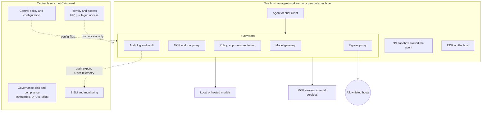

# Cairnward overview

What Cairnward is, and where it sits among the other parts of an agentic system. For the design
in detail see [spec.md](spec.md); for what it doesn't do, [limitations.md](limitations.md); for how
far along it is, [status.md](status.md).

## What it is

A local privacy gateway for AI chat clients and coding agents on one person's machine, or next to
one agent workload. Everything an agent reaches goes through it: a model gateway, an MCP and tool
proxy, a policy engine with human approvals, redaction, an egress proxy (the only way out to the
network), a hash-chained audit log and an encrypted transcript vault. Agents run in an OS sandbox.
The model and its clients are treated as untrusted; enforcement sits outside them.

## Where it sits in an agentic system stack

An enterprise stack for agentic systems has several layers, usually supplied by different
products. Cairnward covers the **runtime** layers on one host, between the agent and everything
it reaches (models, tools, the network, the file system), and produces evidence for the layers
above. It has none of the central layers.

| Layer | Usually supplied by | Cairnward's role |
|---|---|---|
| **Governance, risk and compliance** (AI inventories, DPIAs, model risk management, mapping to the AI Act or ISO/IEC 42001) | GRC platforms, the DPO's and MRM teams' processes | **None.** It produces evidence these processes can use ([what it contributes](compliance-governance.md#what-cairnward-contributes)) |
| **Identity and access** (agents as accounts, roles, privileged access) | Identity provider, privileged-access tooling, workload identity | **Weak.** API keys per client and short-lived keys per run; no users or roles. Approvals come from whoever owns the host |
| **Central policy and configuration** | Policy engines, configuration management | **Local only.** TOML files on the host; deliver them with configuration management and alert on drift |
| **Model gateway** (routing, provider control, budgets) | Commercial AI gateways, LLM proxies | **Yes, on the host.** OpenAI-compatible endpoint; hosted providers allowed, asked about or denied per environment; providers that may train on prompts confined to scratch environments; budgets |
| **Data loss prevention and redaction** | Enterprise DLP, CASB | **Partial.** Text redaction in model, MCP and plugin traffic (its own patterns, optionally Presidio). Attachments and images aren't scanned |
| **Tool and MCP governance** | MCP gateways, agent platforms | **Yes.** Tool definitions pinned by hash, allow / ask / deny per tool, changed tools held for review, untrusted content tracked before user-only actions |
| **Containing the agent on the host** | Containers and VMs, EDR | **Yes.** Agents run in an OS sandbox (srt or OpenShell): writes only to the workspace, the home folder hidden, network only through egress. EDR still watches the whole host |
| **Network egress control** | Secure web gateway, firewall, TLS-inspecting proxy | **Yes, per agent.** Network off by default, host allow-lists or a prompt per host, DNS checks against reaching this machine, optional TLS inspection with method and path rules |
| **Human oversight** | Workflow and approval tools | **Yes, on the host.** Approvals in Cairnward's own interface, never answered by the model |
| **Logging and monitoring** | SIEM, OpenTelemetry pipelines | **Produces the records, doesn't store them centrally.** Hash-chained, content-free audit log with anchors, JSON-lines export and OpenTelemetry spans |
| **Data lifecycle** (retention, erasure, encryption) | Records management, key management | **Yes, for its own data.** Conversations encrypted one by one, crypto-shredding on purge, retention per environment, encrypted backups |

**How to read it:** Cairnward is an enforcement point, not where policy is decided. It keeps
control outside the model, which is treated as untrusted. It fits best where central products are
weak: local or self-hosted models with regulated data, separating data classes or matters, and
agents on people's own machines. The central layers are what a company [must add](compliance-governance.md#what-the-company-must-add),
and the [planned control plane](plan/enterprise-poc.md) would supply some of them. Its first piece, a read-only fleet view of sessions across instances, is [Cairnsteward](https://github.com/c23075/cairnsteward), which is now planned as the full enterprise control plane: users, model risk management and evidence for GRC tools ([ADR-0021](adr/0021-managed-mode.md), proposed).
